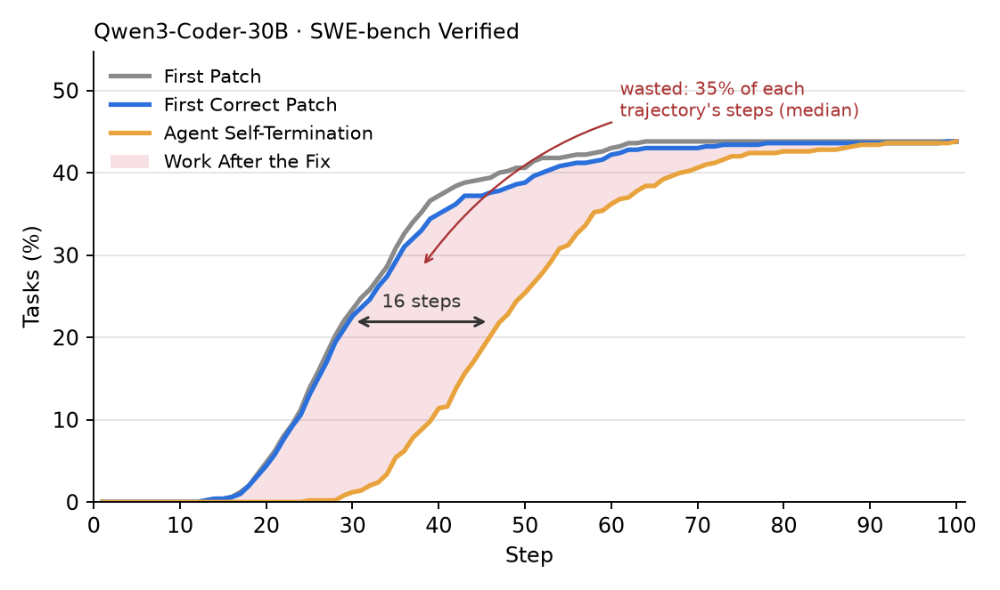
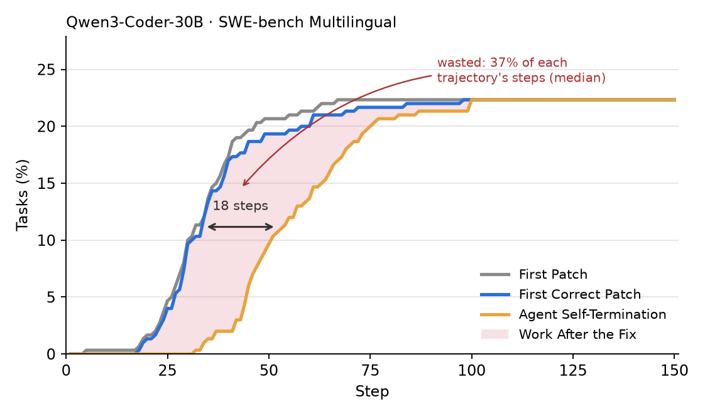
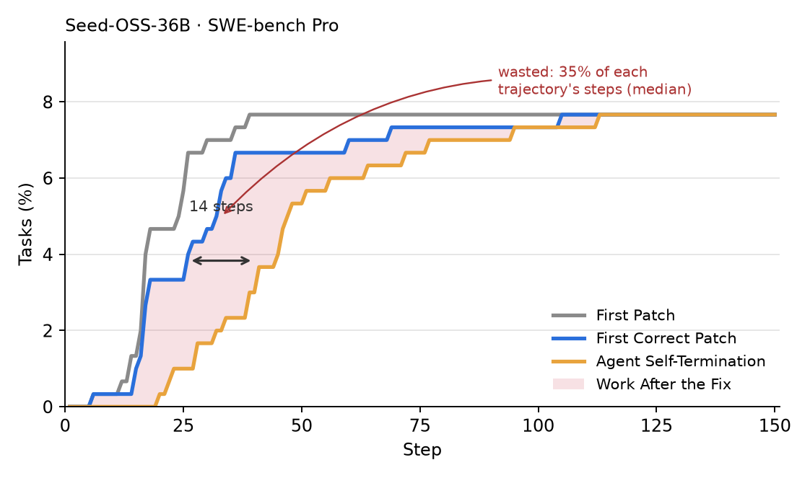
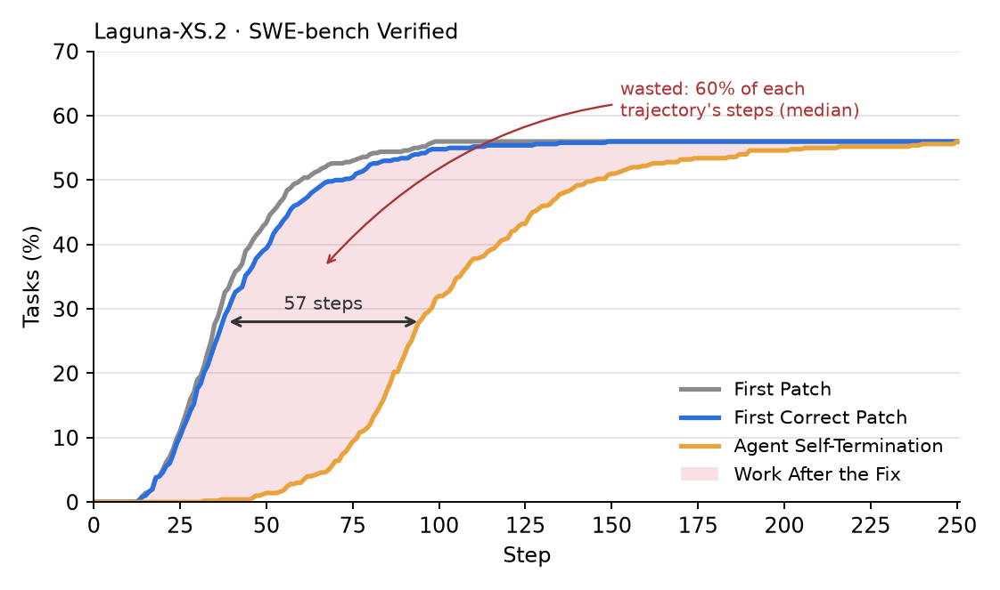
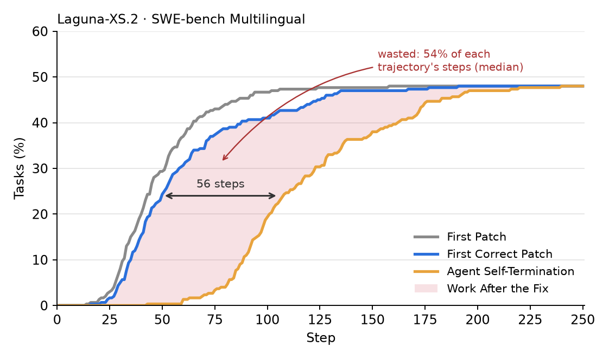
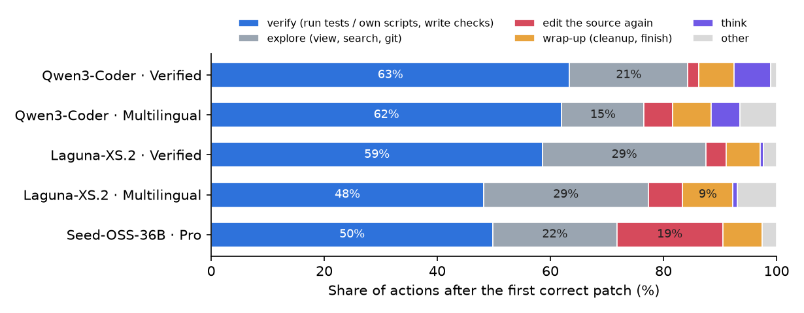

# Termination Lag: Coding Agents Solve Early but Stop Late

Code, prompts and per-step results for the paper
**"Termination Lag: Coding Agents Solve Early but Stop Late"**.

<p align="center">
  <a href="https://arxiv.org/abs/2611.14960"></a>
  &nbsp;
  <a href="https://huggingface.co/datasets/musacim/termination-lag-trajectories"></a>
</p>

Coding agents often have a correct patch long before they stop. We save the repository patch after **every agent
step**, grade every distinct patch with the official SWE-bench tests, and measure **termination lag**: the number of
steps between the first correct patch and the end of the run.



## Main results

Medians over solved runs. TTFCP = step of the first correct patch (F), S = step at which the agent stops,
TL = S - F, NTL = (S - F) / S.

| Model | Benchmark | Solved | TTFCP | S | TL | NTL |
|---|---|---:|---:|---:|---:|---:|
| Qwen3-Coder-30B-A3B | SWE-bench Verified (500) | 43.8% | 30 | 48 | 16 | 35% |
| Qwen3-Coder-30B-A3B | SWE-bench Multilingual (300) | 22.3% | 34 | 54 | 18 | 37% |
| Laguna-XS.2 | SWE-bench Verified (500) | 56.0% | 38 | 95 | 57 | 60% |
| Laguna-XS.2 | SWE-bench Multilingual (300) | 48.0% | 50 | 108 | 55.5 | 54% |
| Seed-OSS-36B | SWE-bench Pro (300) | 7.7% | 26 | 45 | 14 | 35% |
| Qwen3-Coder-30B-A3B, mini-SWE-agent | SWE-bench Verified (500) | 32.4% | 22 | 37 | 12 | 37% |

Reproduce this table from the released data (Python 3 only, no dependencies):

```bash
python scripts/reproduce_table.py
```

## More results

First correct patch and stop step per task, for the other models and benchmarks:

<table>
  <tr>
    <td align="center" width="50%"><br><sub>Qwen3-Coder-30B, SWE-bench Multilingual</sub></td>
    <td align="center" width="50%"><br><sub>Seed-OSS-36B, SWE-bench Pro (300 tasks)</sub></td>
  </tr>
  <tr>
    <td align="center" width="50%"><br><sub>Laguna-XS.2, SWE-bench Verified</sub></td>
    <td align="center" width="50%"><br><sub>Laguna-XS.2, SWE-bench Multilingual</sub></td>
  </tr>
</table>

What agents do after their first correct patch (solved runs): most of the extra steps verify the fix or explore the
repository; source-code edits are rare (2-6% of these steps), except for Seed-OSS-36B on SWE-bench Pro (19%).

<p align="center"></p>

## What is in this repository

```
results/
  per_task/<run>.json          one record per task: the grade of the patch after every step, F, S, final result
  post_fix_actions/<run>.json  what the agent did after its first correct patch, per action category
  first_patch.json             first source edit, first correct patch and number of distinct attempts per task
figures/                       the paper's figures
prompts/                       system, task and tool prompts exactly as the agents received them
scripts/reproduce_table.py     recomputes the table above from results/per_task
scripts/from_hf.py             recomputes the paper's tables from the Hugging Face trajectories
code/
  recording/stepproxy.py       proxy between the agent and the model server; saves the patch after every step
  grading/                     grades every distinct per-step patch with the official tests (Apptainer)
  analysis/                    termination-lag extraction, plots, post-fix action breakdown, first-patch analysis
  mini-swe-agent/              batch runner for the mini-SWE-agent experiments
```

### Per-task record format (`results/per_task/<run>.json`)

```json
{"iid": "django__django-11099",
 "ms": {"1": false, "20": false, "21": true, "35": true},
 "first_edit": 15, "first_correct": 21, "stop": 36,
 "finished": true, "final": true}
```

| Field | Meaning |
|---|---|
| `ms` | step -> does the patch saved after that step pass the official tests (`null`: empty patch). The files hold every step; the example is shortened. The submitted patch is graded separately (`final`). |
| `first_edit` | first step whose patch differs from the initial repository |
| `first_correct` | F, first step whose patch passes (`null` if none) |
| `stop` | S, number of steps the agent ran |
| `finished` | the agent stopped on its own (`false`: step cap, context limit or time limit) |
| `final` | the submitted patch passes |

A step is one model response together with the tool calls it makes.

## Full trajectories

The complete agent trajectories (every message, tool call and observation) and every per-step patch are on
Hugging Face: [musacim/termination-lag-trajectories](https://huggingface.co/datasets/musacim/termination-lag-trajectories).

Recompute the paper's tables (termination lag, first patch, actions after the fix, what happens to the patch) from
that dataset:

```bash
pip install huggingface_hub pyarrow
python scripts/from_hf.py          # add --ctx for the context-growth estimate (also needs: pip install tokenizers)
```

## How the per-step patches are recorded

`code/recording/stepproxy.py` sits between the agent (OpenHands or mini-SWE-agent) and the model endpoint. Before it
forwards each model request, it writes the current `git diff` of the task repository against the base commit, using a
temporary Git index so the agent's repository is untouched. After the run, every distinct patch is graded once in an
isolated container with the benchmark's official tests (`code/grading/`). The agent never sees these grades.

The code in `code/` works on the raw run folders (`runs/<run>/`), which are not part of this release; each script
starts with a one-line description and its usage. Paths are read from the environment variable `TL_ROOT`.

## Citation

```bibtex
@article{cim2026termination,
  title   = {Termination Lag: Coding Agents Solve Early but Stop Late},
  author  = {Cim, Musa and Topcu, Burak and Kandemir, Mahmut Taylan},
  journal = {arXiv preprint arXiv:2611.14960},
  year    = {2026}
}
```

## Acknowledgment

This research used resources of the Argonne Leadership Computing Facility, which is a U.S. Department of Energy
Office of Science User Facility operated under contract DE-AC02-06CH11357.

## License

Code: MIT (`LICENSE`). Data and figures (`results/`, `figures/`, trajectories): CC BY 4.0 (`LICENSE-DATA`).
SWE-bench task content belongs to its original authors and licenses.
